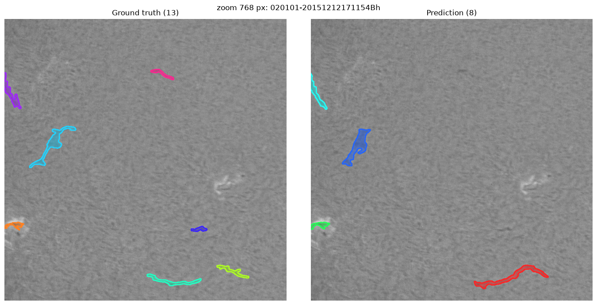
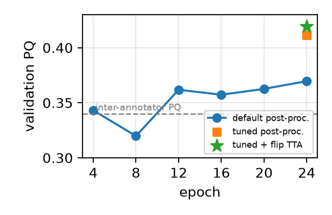
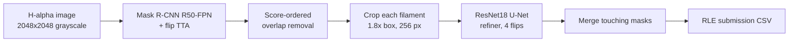

# Solar Filament Segmentation (Kaggle 2026)


Instance segmentation of **solar filaments** (dense, cool plasma suspended above the Sun's surface)
in 2048x2048 GONG H-alpha full-disk images, for the
[Solar Filament Segmentation Challenge 2026](https://www.kaggle.com/competitions/filament-segmentation-2026/)
(NSF National Solar Observatory). Every filament gets its own mask; the score is Panoptic Quality (PQ).


<sub>Validation crop (768 px). Left: annotator masks. Right: this pipeline. Each colour is one filament instance.</sub>

## Highlights

* **Two-stage pipeline:** class-agnostic Mask R-CNN (ResNet50-FPN) finds filaments on the native
  2048 px image, then a ResNet18 U-Net re-segments each one on a full-resolution crop.
  The refiner adds **+0.027 PQ** (0.419 -> 0.447) because Mask R-CNN's 28x28 mask head is too coarse for thin filaments.
* **Beats the inter-annotator ceiling:** two human annotators agree with each other at PQ ~0.34 on
  the same images; the model reaches 0.447 against held-out labels.
* **Runs on a 4 GB laptop GPU** (GTX 1650): native-resolution 1024 px crop training in fp32, about 1 s per image at inference.
* **Disciplined validation:** a fixed train/val split grouped by image timestamp (no leakage across annotators of the same image),
  all thresholds tuned on validation only, never on the leaderboard. Our PQ code matches the organisers' scorer exactly.
* **Fully reproducible:** committed weights, YAML configs, fixed seeds, and one notebook that regenerates the submission byte for byte.

## Results

| | Validation PQ | Public LB |
|---|---|---|
| Epoch 4 checkpoint | 0.375 | 0.33 |
| Epoch 24 | 0.414 | 0.36 |
| Epoch 24 + 3-view flip TTA | 0.419 | 0.37 |
| **+ crop refiner (stage 2), weights in this repo** | **0.447** | **0.38** |
| Same pipeline retrained on train + val | n/a | 0.39 |
| Inter-annotator agreement (reference) | ~0.34 | – |

<p align="center"></p>

### Things that did not help (validation PQ, baseline 0.4193 / 0.4467 with refiner)

| Idea | Result |
|---|---|
| Rotation TTA (4 or 8 dihedral views) | 0.415-0.418, worse than flips only |
| Seed ensemble (2 detectors) | 0.419, no gain |
| Mask R-CNN v2 + smaller anchors | 0.417 |
| Classifier loss x3 (fewer confident false positives) | 0.443 with refiner |
| 2x zoomed tile inference for small filaments | 0.404, adds confident false positives |
| 1 px mask dilation | 0.392 |

Error analysis on validation: most misses are small filaments (recall 28% for 200-500 px objects);
most false positives are large and confident, which points at label noise as much as model error.



## Quick start (reproduce the submission without retraining)

```bash
git clone https://github.com/Saggy7276/filament-seg-2026.git && cd filament-seg-2026
python -m venv .venv && .venv/Scripts/activate        # Linux/macOS: source .venv/bin/activate
pip install -r requirements.txt --extra-index-url https://download.pytorch.org/whl/cu126
# put the competition data in MAGFiLO_1.0_Kaggle_2026/ (train/ and test/ as distributed)
jupyter notebook notebooks/pipeline.ipynb               # run all cells
```

The notebook loads `weights/maskrcnn_r50_filament.pt`, the tuned post-processing in
`weights/maskrcnn_r50_filament_tta.pp.json` and the refiner `weights/refiner_r18_filament.pt`,
reports validation metrics and figures, and writes `submissions/submission.csv`.
Equivalent command line:

```bash
python -m src.predict --config configs/refined_tta.yaml --weights weights/maskrcnn_r50_filament.pt \
    --pp weights/maskrcnn_r50_filament_tta.pp.json --refiner weights/refiner_r18_filament.pt \
    --submit --out submissions/submission.csv
```

Retrain (GTX 1650 4 GB: detector about 3.7 h from COCO weights, refiner about 1.2 h from ImageNet weights):

```bash
python -m src.train --config configs/baseline.yaml
python -m src.train --config configs/baseline.yaml --resume runs/<run_dir>   # continue an interrupted run
python -m src.refiner --config configs/refiner.yaml
python tools/eval_refiner.py --refiner runs/<refiner_run>/best.pt            # validation study of stage 2
```

## Pipeline

1. **Data** (`src/data.py`). Images are loaded as single-channel 8-bit grayscale. Only the
   `segmentation` polygons are used as targets; spines, boxes and chirality classes are not used,
   following the competition rules, so all filaments form a single class. Images labelled by
   several annotators give several training samples.
2. **Split.** 15% of the unique images (106) are held out for validation, grouped by image
   timestamp so the same image never appears in both sets, and stratified by observatory.
   The split is stored in `splits/split_seed42.json` and used by every experiment.
3. **Training** (`src/train.py`). Random 1024x1024 crops at native resolution (80% centred near a
   filament), horizontal/vertical flips, 90-degree rotations, brightness/contrast/gamma jitter.
   SGD (lr 0.005, momentum 0.9, weight decay 1e-4), effective batch 4 (batch 1 x 4 accumulation),
   linear warm-up then cosine decay, 24 epochs, fp32. Validation PQ every 4 epochs; best kept.
4. **Inference** (`src/predict.py`). Full 2048x2048 image, about 1 s/image on a GTX 1650.
5. **Post-processing** (`src/postprocess.py`). Detections are painted in descending score order;
   each pixel belongs to at most one filament, and a detection is dropped if less than 50% of it
   survives (mask-level NMS). Score threshold, mask threshold and minimum area are grid-searched
   on the validation split only.
6. **Crop refiner** (`src/refiner.py`, `configs/refiner.yaml`). Mask R-CNN predicts each mask on a
   28x28 grid inside its box, which is coarse for thin filaments. Each instance from step 5 is
   re-segmented by a ResNet18 U-Net on a square native-resolution crop centred on it (side = 1.8 x
   the larger box side, at least 96 px, resized to 256x256, four flip views averaged, threshold
   0.4). Refined masks that touch are merged into one filament; an instance keeps its detector mask
   if the refiner returns nothing. The refiner is trained on the training split only, on one crop
   per ground-truth filament with random context (1.4-2.3) and centre shift to imitate imperfect
   detector boxes (BCE + Dice loss, AdamW, 24 epochs). On validation it raises PQ from 0.419 to
   0.447 (TP 706 -> 727, FP 415 -> 368).
7. **Submission.** One row per filament, `filament_id = <image_id>_<k>`, `segmentation_rle` =
   pycocotools RLE counts string. `validate_submission` checks ids, format, and that every RLE
   decodes to a non-empty 2048x2048 mask.

## Evaluation (`src/metrics.py`)

* **PQ** = sum IoU(TP) / (|TP| + 0.5|FP| + 0.5|FN|), match when IoU > 0.5 (own implementation; pycocotools
  COCOeval computes AP, not PQ).
* **Dice**: binary Dice of all predicted vs all GT filament pixels per image; also computed with
  `torchmetrics.segmentation.DiceScore` in the notebook (identical values).
* **IoU / Dice distributions** per GT filament, and **one-to-many** (a GT covered by >= 2 predictions
  each > 50% inside it) and **many-to-one** (a prediction covering >= 2 GTs each > 50% inside it) counts.

## Repository layout

```
configs/                  all hyperparameters (refined_tta.yaml = final pipeline, refiner.yaml = stage-2 training)
splits/split_seed42.json  fixed train/val split
src/                      data, models, train, refiner, predict, postprocess, tta, metrics, visualize, utils
notebooks/pipeline.ipynb  end-to-end reproduction (generated by tools/build_notebook.py)
weights/                  final weights (fp16, BatchNorm stats fp32) + tuned post-processing
results/                  results.csv (every run), submissions_log.csv
tests/test_pipeline.py    metric / post-processing / RLE tests
tools/                    notebook builder, notebook smoke test, TTA / ensemble / refiner evaluation
```

## Reproducibility notes

* Seeds are fixed (`seed: 42`, re-seeded every epoch so resumed runs match) and logged per run.
* Weights are stored in fp16 to stay under GitHub's 100 MB file limit; BatchNorm running statistics
  are kept in fp32 because torchvision uses `eps=0` for frozen BatchNorm with COCO weights, and tiny
  variances underflow in fp16.
* Mixed precision is disabled: on the GTX 1650 it produced NaN mask losses and was slower than fp32.

## Acknowledgement

The two-stage design (detector followed by a crop-level U-Net refiner, merging masks that overlap)
follows the public Kaggle notebooks "Mask R-CNN + U-Net Refiner" by Nomannic19 and
"LB 0.70 | Topology-Safe Solar Filaments" by Fususu. The code in this repository was written
independently and all weights were trained by us on the competition training split; no
checkpoints from those notebooks are used.

## License / data

Code is released under the MIT License (see `LICENSE`). Competition data are not included and are
used for non-commercial research purposes under the competition rules.
